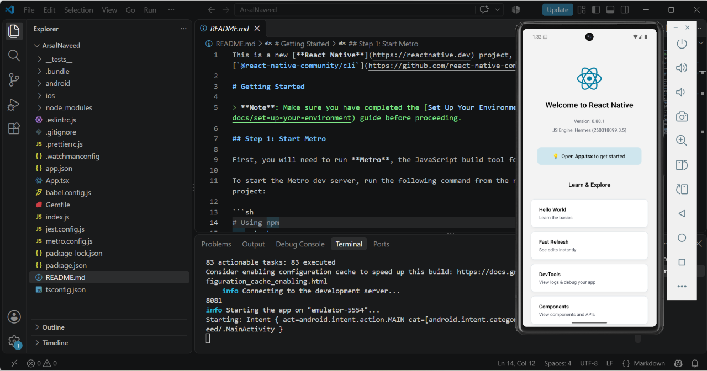
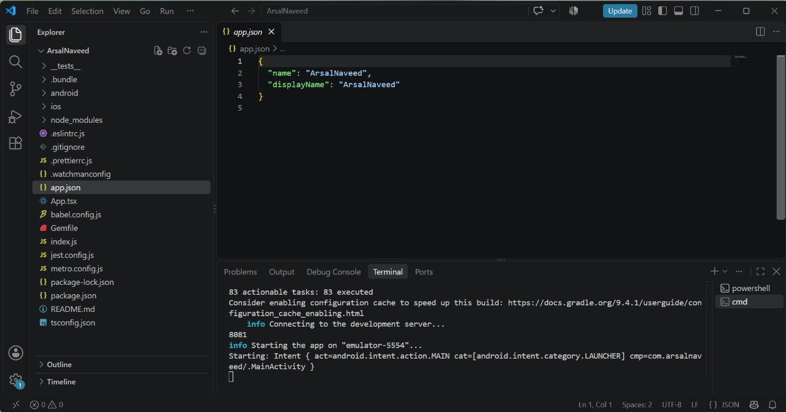

# Mobile Application Development - Assignment 1
- Name: Arsal Naveed
- ID: F2023266900
- Course: Mobile Application Development V1
- Instructor: M. Shahbaz Ali
- University: University of Management and Technology (UMT)

## Technologies Used
- React Native
- JavaScript / TypeScript
- Android Studio
- Visual Studio Code

## Project Setup
This project was created using the React Native Community CLI and tested on an Android emulator.

## Screenshots

### App Running on Android Emulator

### Project Structure in VS Code

